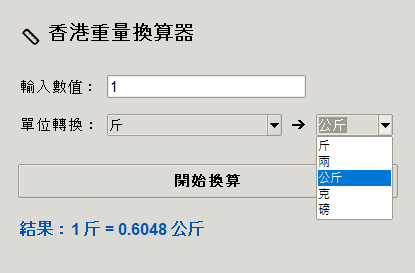

```text
[init] The repo that should have belonged to a time before my skin even formed.
[source] The documentation of where I was born.
[commit] Just a rambling scripting collection committed to the future.
```

# 用代碼建寫屬於我認為嘅香港人根源

## 工具 
- [香港常見重量單位換算(斤、兩、公斤、克、磅)](tools/hk_weight_converter_gui.py)<br>


## 字體
 - [蘋方+Segoe UI Variable](fonts/PingFangSegUIVarHybrid.ttf)
     - Windows 1080p 用戶要用 [MacType](https://github.com/snowie2000/mactype) 去模糊
 - [微軟正黑體+Verdana](fonts/JhengHeiVerdanaHybrid.ttf)